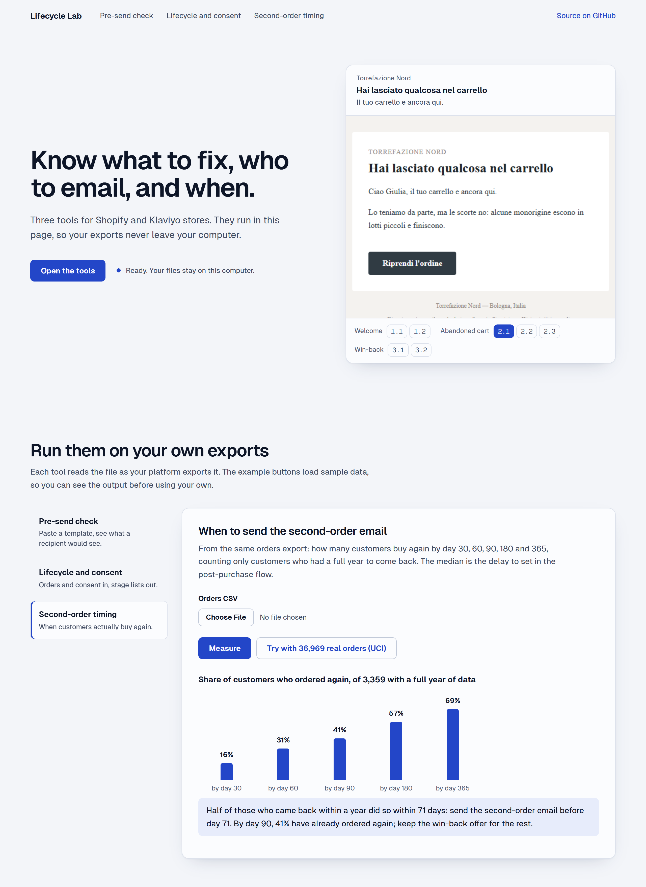

# Lifecycle Automation Lab

This is a **simulated coffee shop on a Shopify development store**. The orders
were created for the exercise. The welcome, abandoned-cart and win-back flows
ran in Klaviyo using an authenticated sending domain. One consenting test
subscriber received three emails. The [run log](reports/results.md) documents
those deliveries. The shop had no paying customers or commercial sales.

## Use it on your own store

**[Open the tools in your browser](https://errer441122.github.io/klaviyo-lifecycle-lab/)**:
load your own CSV files, see the result, download the lists. The page runs
this repository's Python in the browser, so nothing leaves your computer and
nothing needs installing. Each tool has a "try it" button with the example
files, which are only there to show what the output looks like.

[](https://errer441122.github.io/klaviyo-lifecycle-lab/)

The page opens on the seven flow emails as a recipient sees them, with the
Klaviyo tags filled in the way Klaviyo's own preview does. Below are the three
tools, one tab each (in the picture, the second-order timing on the 36,969
public UCI orders), and the three flows as built in Klaviyo.

The same three tools run from the command line, where the lifecycle sync can
also write to Klaviyo (with `--live` and an API key; never from the page):

| Task | Command | What you get |
| --- | --- | --- |
| Check a template before it goes live | `python src/pre_send_check.py email.html --subject "..."` | Every problem a recipient would see: a greeting that reads "Ciao ,", a dead link, a hand-typed UTM that breaks the naming rules, no unsubscribe link, a subject cut off on a phone |
| Lifecycle stages from a Shopify orders export | `python src/sync_klaviyo.py --orders orders_export.csv --consent consent.csv --suppressed suppressed.csv` | Each customer's stage (New, Repeat, At risk, Dormant, Churned), written to Klaviyo only for people whose consent has a recorded source and date, plus the list of everyone held back and why |
| Time the second-order email | `python src/repeat_timing.py --orders orders_export.csv` | The share of customers who order again by day 30, 60, 90, 180 and 365, and the delay to put in the post-purchase flow |

The orders file is the Shopify export as it comes out of *Orders > Export*: the
line items of each order are folded into one order, and cancelled, refunded and
voided orders are left out. Files saved again by Excel work too: comma,
semicolon or tab as separator, decimal commas (`49,90`, `1.234,50`), dates as
`YYYY-MM-DD` or `DD/MM/YYYY`, with or without the byte-order mark, and in the
browser also the older Windows encoding. Files and columns:
[`data/README.md`](data/README.md).

So far the Shopify reading is tested on handwritten files in Shopify's export
layout ([`data/shopify_orders_example.csv`](data/shopify_orders_example.csv)),
not on a large store. The timing tool was also run on the 36,969 real orders of
the public UCI dataset ([`data/online_retail_orders.csv`](data/online_retail_orders.csv),
source and licence in [`data/REAL_DATA_PROVENANCE.md`](data/REAL_DATA_PROVENANCE.md)):
3,359 customers with a full year of data, half of those who came back within 71
days.

## What is real and what is not

| Real | Not real |
| --- | --- |
| A Klaviyo account with three live flows and seven emails | The store is a Shopify development store: password-protected, with no real customers |
| A sending domain I authenticated myself (DKIM and DMARC), checked against the public DNS records | The orders in it were seeded by me |
| A double opt-in list, and a rule that no profile is touched without consent | One subscriber, three delivered emails, no clicks and no sales |

So this repository shows that the mechanism works end to end. It does not show
performance: there is no open rate, click rate or revenue worth reporting, and
[the results](reports/results.md) report counts, never rates.

## What I found by running it

These only showed up because the flows were actually sent, not just drawn.

1. **Smart Sending skipped the first abandoned-cart email.** A welcome email
   had gone out five hours earlier, so Klaviyo held back the cart email. Nothing
   in the reports said so: no send, no error. One screen in Klaviyo names the
   reason. The next email in the same flow went out a day later, once the window
   had passed.
2. **Double opt-in on a list does not protect the list.** A sign-up through
   Shopify's own newsletter field arrived in Klaviyo as subscribed straight
   away, with no confirmation email. The setting only protects sign-ups that
   come through the Klaviyo form.
3. **A green "Verified" was not my configuration.** The first domain I tried
   was parked on a resale marketplace that answered every DNS check. Klaviyo
   showed the domain as verified although I had configured nothing. Since then
   I check the DNS records myself instead of trusting the status column.

One thing is still unproven: I have not yet seen the abandoned-cart flow stop
when the customer completes the order, because Smart Sending got in the way of
the one test I ran. The results describe the test that would settle it.

Full write-up, including what else broke: [`reports/results.md`](reports/results.md).

## Checking an email before it goes live

[`src/pre_send_check.py`](src/pre_send_check.py) checks the seven emails before
their HTML is pasted into Klaviyo, and any other Klaviyo template copied into a
file: every personalisation tag has a fallback,
every link is a real https address, any hand-typed UTM follows the
[taxonomy](docs/flows.md#measurement), the unsubscribe link is there, the
subject fits on a phone (50 characters) and the preview text adds something to
it. CI runs it on every change.

Its first run flagged all seven emails that were live. Six greeted the reader
with `Ciao {{ first_name|default:'' }},`, which reads "Ciao , grazie..." for
anyone who signed up without a first name, and the three cart emails had no
fallback if Shopify's checkout link is missing. Both are fixed in this
repository; the emails in Klaviyo change when the new HTML is pasted in.

## The flows

| # | Flow | Trigger | Steps |
| --- | --- | --- | --- |
| 1 | Welcome | Added to the double opt-in list, so only after confirmation | Day 0 → wait 3 days → Day 3 |
| 2 | Abandoned cart | `Checkout Started`, with the filter *Placed Order zero times since starting this flow* re-checked before every send | 4h → email → 20h → email → 2 days → email |
| 3 | Win-back | Entry into the `At risk` segment, which reads a profile property written by [`src/sync_klaviyo.py`](src/sync_klaviyo.py) | Day 0 → wait 7 days → Day 7 |

Specification and the reason for each delay: [`docs/flows.md`](docs/flows.md).
Consent design: [`docs/consent.md`](docs/consent.md).
Domain authentication: [`docs/deliverability.md`](docs/deliverability.md).


More screenshots (welcome flow, segment, double opt-in setting, DNS answers,
Shopify admin) are in [`assets/`](assets).

## How a customer enters the win-back

Each customer gets a lifecycle stage based on the date of their last order.
The stage is saved on the Klaviyo profile, a Klaviyo segment collects everyone
who is "At risk", and entering that segment starts the win-back flow.

```
order history + consent  ->  lifecycle stage on the profile  ->  "At risk" segment  ->  win-back flow
```

| Stage | Rule |
| --- | --- |
| New | last order ≤ 90 days ago, 1 order |
| Repeat | last order ≤ 90 days ago, ≥ 2 orders |
| At risk | last order 91-180 days ago |
| Dormant | last order 181-365 days ago |
| Churned | last order > 365 days ago |

The thresholds are the same ones I used in an earlier RFM and retention
analysis of the UCI orders.

Consent comes first: only profiles that have already opted in are updated, and
only if the consent record says where and when the consent was given, because
under GDPR the shop must be able to show it. The source and date are written on
the profile next to the lifecycle stage. Everyone held back is listed in a
report, which also counts subscribers by sign-up source: that is where the
Shopify checkbox subscribers from finding 2 show up. Nothing in this project
can subscribe a person who did not ask for it.

## Real-World Business Application (Next Steps)

What I would do on a store with real customers.

1. **Turn Smart Sending off on high-intent flows.** Smart Sending stops a
   person from receiving two emails within a set window. That is right for
   newsletters, but an abandoned cart is the moment the customer is closest
   to buying. In this lab I left it on to document the behaviour, and it cost
   the first cart email. On a real store I would switch it off for abandoned
   cart and order emails, and keep it on for campaigns.
2. **Use the segments to decide who gets a discount.** A discount sent to
   everyone is paid mostly by people who would have bought anyway. The
   win-back offer here goes only to customers whose last order was 91 to 180
   days ago, and only once. Recent and loyal customers get content, not money
   off.
3. **Treat consent as a rule of the whole system, not one setting.** Double
   opt-in on the list was not enough: the Shopify newsletter checkbox went
   around it. On a real store I would send every sign-up source through the
   same confirmed opt-in, keep the date and source of each consent, and check
   the list for unconfirmed profiles regularly. Under GDPR the shop has to be
   able to show how each person consented.
4. **Measure with real traffic.** With one subscriber there is nothing to
   measure. The next step is a store with real visitors, where each flow can be
   judged on revenue per recipient and unsubscribe rate.

## Run the example

The lifecycle rules can be tried on the example data without any account:

```bash
python -m unittest discover -s tests
python src/pre_send_check.py
python src/sync_klaviyo.py --orders data/shopify_orders_example.csv --as-of 2026-06-01 --suppressed reports/suppressed.csv
python src/repeat_timing.py --orders data/shopify_orders_example.csv
```

The sync is a dry run: it prints who would be updated and who is held back for
missing or unprovable consent, writes the suppression list, and sends nothing.
The timing tool will say that the example covers only five months: it needs
customers with a full year of data after their first order. Writing to a real Klaviyo account needs an
API key and the `--live` flag.

## Boundaries

- No purchased, scraped or imported lists. The only recipient confirmed through
  double opt-in.
- The example CSVs use `example.com` addresses, which cannot receive mail.
- The numbers are a snapshot from 31 August 2026.

## How I built this

I am a Digital Marketing student, not a developer. The Python scripts were
written mostly by AI coding assistants. My part was setting up and running the
Klaviyo and Shopify accounts and the DNS, defining the rules (consent, triggers,
timing), checking what was actually sent and deciding what to report, including
what did not work.

## Licence

MIT. See [LICENSE](LICENSE).
